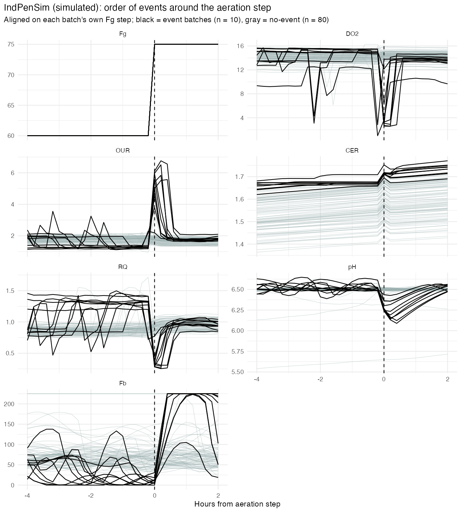
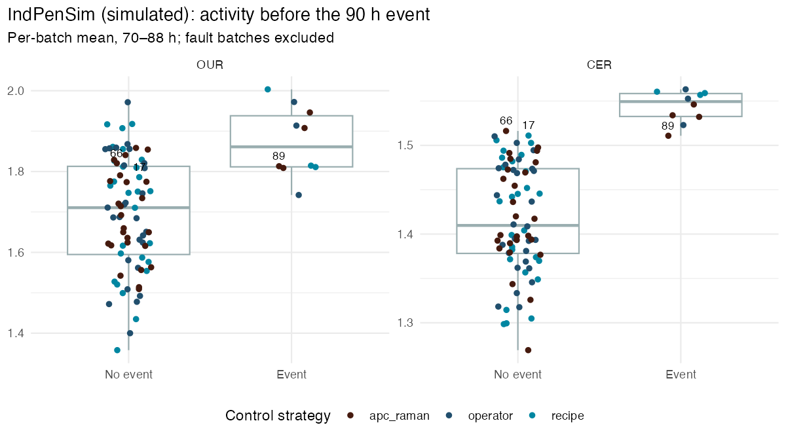
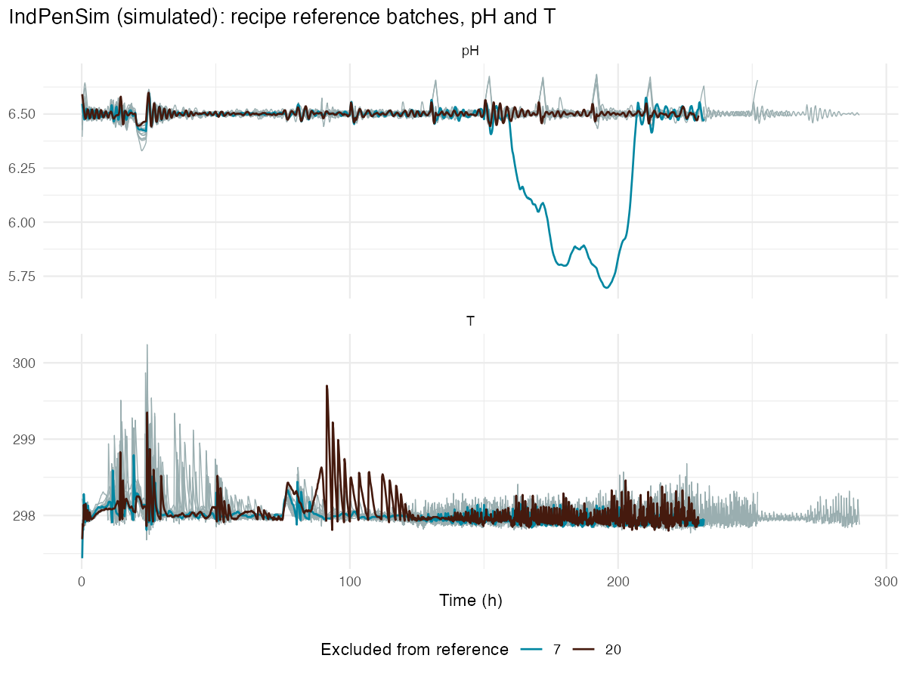
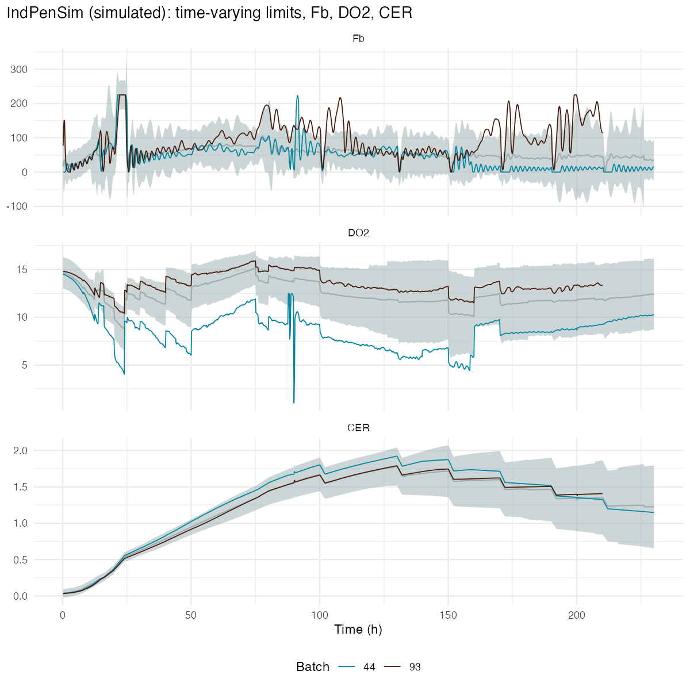

```{r setup}
library(data.table)
library(knitr)
res <- function(f) fread(here::here("results", f))

pre   <- res("event_pre_activity.csv")
steps <- res("event_90h_timing.csv")
tim   <- res("m1_detection_timing.csv")
summ  <- res("m1_summary.csv")
ceil  <- res("fb_ceiling_hours.csv")

p_cer <- suppressWarnings(wilcox.test(CER ~ disturbance_90h, data = pre)$p.value)
p_our <- suppressWarnings(wilcox.test(OUR ~ disturbance_90h, data = pre)$p.value)
med   <- pre[, .(CER = median(CER), OUR = median(OUR)), by = disturbance_90h]
cer_event_min   <- pre[disturbance_90h == TRUE,  min(CER)]
cer_noevent_max <- pre[disturbance_90h == FALSE, max(CER)]
n_above <- pre[CER >= cer_event_min, .N]
n_above_event <- pre[CER >= cer_event_min & disturbance_90h == TRUE, .N]
ev <- steps[disturbance_90h == TRUE]
f2 <- function(x) formatC(x, format = "f", digits = 2)
fp <- function(p) { e <- floor(log10(p)); sprintf("%.1f × 10<sup>%d</sup>", p / 10^e, e) }  # p-values for gfm
```

> **All data in this report is simulated.** It comes from the IndPenSim benchmark, not from a real plant.

## Summary

- Eleven of the 100 batches show a sharp dissolved-oxygen (DO2) crash at about 90 h that no label column in the dataset marks. Ten of them are normal-operation batches; one is a fault batch.
- The affected batches produce more CO₂ before the event: their carbon evolution rate (CER) is higher at similar oxygen uptake, and they are already oscillating hours before the observed disturbance.
- At the scheduled aeration step (90.2 h in every batch), these batches crash: DO2 and pH drop within one sample, the base pump hits its maximum for 1–1.5 h, and pH takes about 2 h to recover.
- Univariate control charts flag most of these batches as unusual, but before the event happens, not when it happens. They also alarm on 10 of 27 normal test batches.
- M2 will test whether multivariate monitoring (PCA with Hotelling's T² and Q) can detect the event itself with fewer false alarms.

## Purpose

This first milestone has two aims: characterize an unlabeled disturbance found while exploring the data, and set a univariate monitoring baseline for it. The baseline is what the multivariate model in M2 has to beat.

## Data

- **Source:** IndPenSim, a simulated 100,000 L fed-batch penicillin fermentation (Goldrick et al., 2015; 2019). Dataset DOI [10.17632/pdnjz7zz5x.2](https://doi.org/10.17632/pdnjz7zz5x.2), license [CC BY 4.0](https://creativecommons.org/licenses/by/4.0/). The data was subset and transformed here; raw files are not in this repository.
- **Batches:** 1–30 recipe-driven, 31–60 operator-controlled, 61–90 advanced process control using Raman, 91–100 with labeled faults. Data is sampled every 0.2 h.
- **Event batches:** batches whose DO2 drops below 6 mg/L between 80 and 110 h (`R/03_screen_variables.R`): 6, 18, 27, 32, 42, 44, 64, 68, 70, 89 and 100.
- **Split** (`splits/batch_split.csv`, seed 20261031): within each control strategy, two-thirds train and one-third test. Event batches form their own test group (batch 100 stays with the faults), so no model learns from them. Result: 53 train, 27 normal test, 10 event, 10 fault.

## The 90 h event

### What happens



Every batch receives the same aeration step, from `r ev$fg_before[1]` to `r ev$fg_after[1]` L/h at `r ev$t_step[1]` h. In the no-event batches it causes only a small blip. In the event batches:

- **Before the step**, from at least 86 h, the event batches are already unstable: oxygen uptake (OUR), the CER/OUR ratio, base flow (Fb) and pH oscillate where the other batches are flat.
- **At the step**, DO2 crashes, OUR spikes, the CER/OUR ratio drops and pH falls from 6.5 to about 6.1, all within one 0.2 h sample. At this resolution their order can't be resolved.
- **After the step**, base flow, the pH controller's output, rises to its maximum within about 0.4 h and stays there for 1–1.5 h. pH takes about 2 h to recover.

```{r timing}
kable(ev[order(batch), .(Batch = batch, `Aeration step (h)` = t_step,
                         `DO2 minimum (h)` = t_do2_min, `DO2 minimum (mg/L)` = f2(do2_min),
                         `Lag (h)` = lag_h)],
      caption = "Aeration step vs DO2 minimum in the 10 normal-operation event batches. Negative lag: DO2 minimum before the step.")
```

In 8 of 10 batches the DO2 minimum falls within one sample of the step. Batches 32 and 64 bottom out 2.2 h *before* it. Batch 64 also has the shallowest dip, so the step may not be the only trigger.

*Code:* `R/09_event_zoom.R`

### Which batches get it



Before the event (70–88 h), the event batches have a higher CER: median `r f2(med[disturbance_90h == TRUE, CER])` vs `r f2(med[disturbance_90h == FALSE, CER])` (Wilcoxon p = `r fp(p_cer)`). The groups barely overlap: the lowest event batch sits at `r f2(cer_event_min)`, and only `r n_above - n_above_event` no-event batches reach that level. OUR is also higher on average (p = `r fp(p_our)`), but its ranges overlap widely. The event occurs in all three control strategies. The hypothesis was generated and tested on the same batches, so this result is exploratory; M2's held-out batches are the first independent check.

Batches near the boundary show the effect is graded. Batch 89 has the event with the lowest CER of the group, and batches 66 and 17 sit at the same level without it. Batch 61 (CER 1.50) shows strain without the crash: its pH stays below 6.3 from 79 to 89 h and its base pump spends 22 h at maximum, against a median of 3 h.

*Code:* `R/05_event_90h_test.R` (boxplot and tests), `R/09_event_zoom.R` (base-pump hours)

### Working hypothesis

Batches with high CO₂ production strain the pH loop before 90 h. The aeration step then pushes them over: the base pump saturates and pH falls until the disturbance passes. This is an association in simulated data, not a confirmed mechanism. OUR and the CER/OUR ratio are calculated from the off-gas balance, and their spikes at the step may partly be calculation artifacts. DO2, pH and base flow are direct measurements and tell the same story.

## Can univariate control charts see it?

### Method

The charts follow the control loops. pH and temperature (T) are controlled variables and get fixed limits. Base flow (Fb, the pH controller's output), DO2 and CER follow a trajectory through the batch and get time-varying limits.

- **Reference:** 16 recipe training batches. Two batches with unlabeled excursions were excluded as Phase I clean-up: batch 7 (pH, 161–206 h) and batch 20 (temperature, about 90 h).
- **Fixed limits:** mean ± 3 SD after 50 h of start-up.
- **Time-varying limits:** mean ± 3 SD across reference batches at each 0.1 h point, with at least 10 reference batches per point. The SD is floored at its 10th percentile, and the lower limit at 0.
- **Batch-level alarm:** a batch is flagged for a variable when its share of time outside the limits exceeds the worst reference batch, and flagged overall if any variable flags it.
- **Timing:** the first point outside the limits, compared with onset: 88 h for events, the earliest DO2 minimum among the event batches (32 and 64); the fault reference signal for faults.

*Code:* `R/06_control_charts_fixed.R`, `R/07_control_charts_varying.R`, `R/08_detection_timing.R`





### Results

```{r summary}
lab <- c(test = "Normal (test)", test_disturbance = "90 h event", test_fault = "Faults 91–100")
kable(summ[, .(Group = lab[role], `All five charts` = all5, `Without Fb` = no_fb)],
      caption = "Batches flagged by the end of the batch.")
st <- dcast(tim[, .N, by = .(role, status)], role ~ status, value.var = "N", fill = 0)
kable(st[, .(Group = lab[role], `Before onset` = `before onset`, `After onset` = `after onset`,
             Missed = if ("missed" %in% names(st)) missed else 0)],
      caption = "First alarm relative to onset, for flagged batches.")
```

- **The event is not detected when it happens.** 7 of the 10 event batches first alarm 37–78 h before onset, consistent with these batches being different all along. Batch 18 alarms at 86.2 h, during the instability before the step. Only batch 89 alarms after onset, 45 h late; batch 64 is missed.
- **Normal batches alarm often:** 10 of 27 with all five charts, 7 of 27 without Fb.

### Base flow: controller effort, not noise

Most Fb alarms on normal batches are long stretches at high base flow, spread evenly across the three control strategies. Fb is the pH controller's output, so these stretches show the controller working hard to hold pH. A separate check counts hours at the base-pump maximum (Fb ≥ 224 L/h) in each no-event batch:

```{r ceiling}
kable(ceil[h_Fb_max > 10][order(-h_Fb_max)][, .(Batch = batch, `Hours at maximum` = h_Fb_max,
       `CER 70–88 h` = f2(CER_70_88), Role = role, Strategy = strategy)],
      caption = sprintf("No-event batches with more than 10 h at the base-pump maximum (median across all no-event batches: %.1f h).",
                        median(ceil$h_Fb_max)))
```

The check finds batch 7, already excluded on other grounds, which supports it as a screen. Most of these batches have ordinary CER, so base-pump saturation has more than one cause. Five of the seven are Raman-APC batches; with so few batches, that is an observation, not a finding. The training batches on this list are review candidates for the M2 reference set.

*Code:* `R/09_event_zoom.R`

## Faults 91–100 (secondary)

All ten fault batches are flagged, with or without Fb. Eight alarm at the first sample after the fault starts, consistent with sudden faults. The other two (93 and 96) alarm earlier for unrelated reasons, so their response after onset is not measured here.

## Limits

- **Simulated data.** Results describe the IndPenSim simulator, not a real process.
- **Exploratory hypothesis.** The CER difference was found and tested on the same batches.
- **Event definition.** Event batches were identified by a DO2 threshold chosen during exploration, not by a dataset label.
- **In-sample threshold.** The batch-level threshold comes from the same reference batches that set the limits, which makes it optimistic.
- **End-of-batch rule.** The share-of-time rule can only be judged when a batch ends; timing here is the first point outside limits, not real-time detection.
- **Small, recipe-only reference.** 16 recipe batches set limits that are applied to operator and Raman-APC batches.
- **One variable at a time.** The charts can't distinguish a high base flow that matches high CO₂ production from one that doesn't.

## Next: M2

PCA on the normal training batches, monitored with Hotelling's T² and Q. Before fitting, the reference set and the treatment of event batches will be fixed and recorded. The questions:

1. Does T² or Q detect the event at 90 h, rather than only flagging the batch as different?
2. Does it pick up the milder cases (66, 17, 61)?
3. Does it do this with far fewer than 10 of 27 normal batches alarmed?

## References

- Goldrick S., Ştefan A., Lovett D., Montague G., Lennox B. (2015). The development of an industrial-scale fed-batch fermentation simulation. *Journal of Biotechnology*, 193:70–82.
- Goldrick S., Duran-Villalobos C.A., Jankauskas K., Lovett D., Farid S.S., Lennox B. (2019). Modern day monitoring and control challenges outlined on an industrial-scale benchmark fermentation process. *Computers & Chemical Engineering*. doi:10.1016/j.compchemeng.2019.05.037
