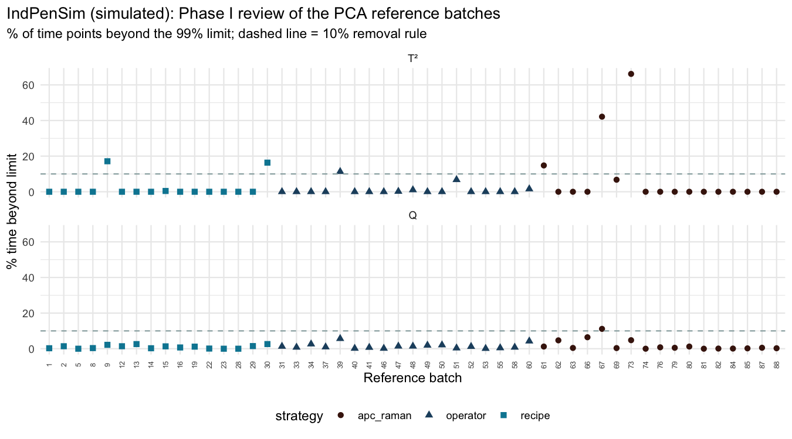
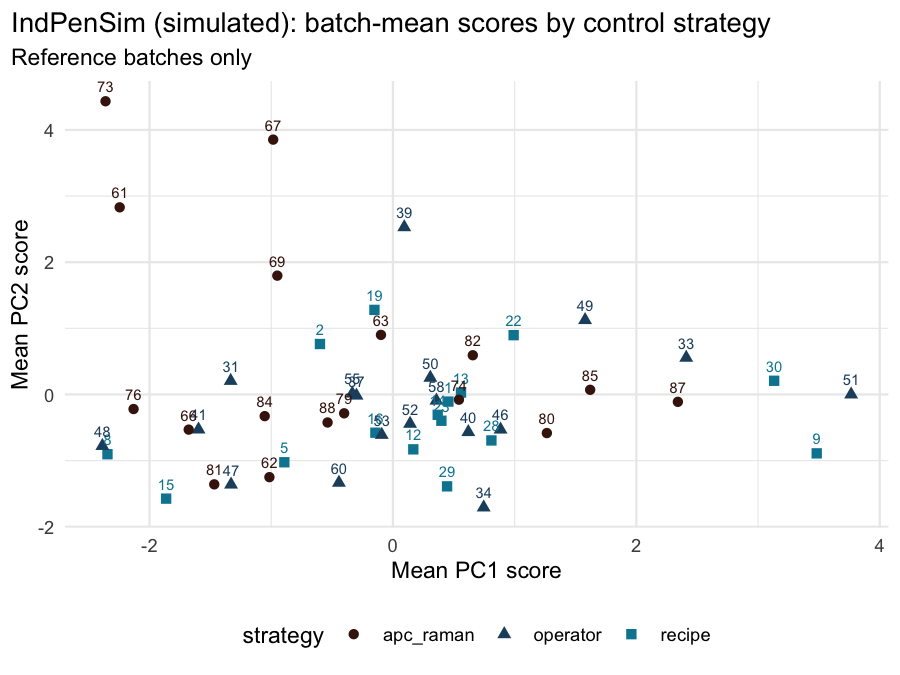
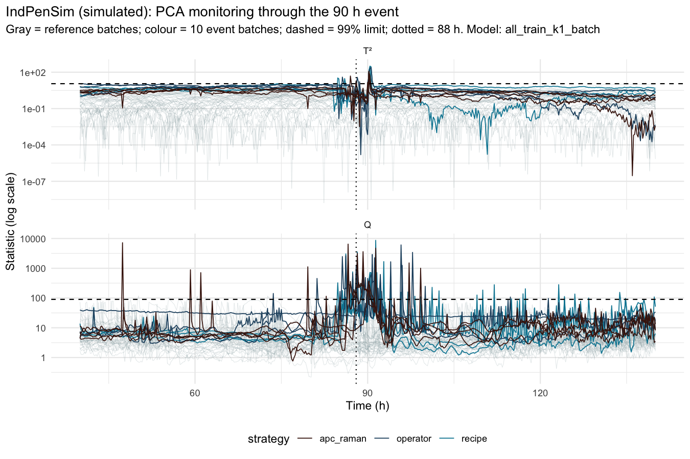
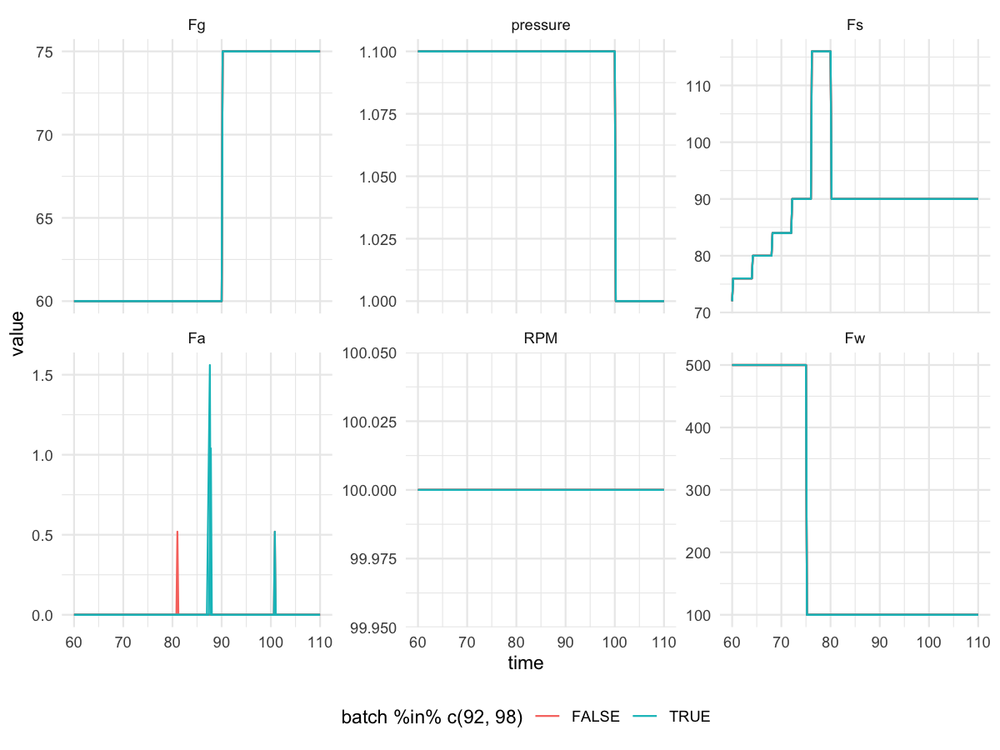

```{r setup}
library(data.table)
library(knitr)
res <- function(f) fread(here::here("results", f))

m2b  <- res("m2_detection_all_train_k1_batch.csv")    # primary: batch-calibrated limits
m2s  <- res("m2_detection_all_train_k1_sample.csv")   # pre-registered: per-sample 99% limits
m1   <- res("m1_detection_timing.csv")
m1s  <- res("m1_summary.csv")
comp <- res("pca_components_all_train.csv")           # final model (after Phase I)
lim  <- res("pca_limits_all_train.csv")                # theoretical 99% limits, final model
limb <- res("pca_limits_used_all_train_k1_batch.csv")  # batch-calibrated limits
p1x  <- res("phase1_excluded_all_train.csv")
p1r  <- res("phase1_check_refit_all_train.csv")

frac  <- function(x) paste0(sum(x, na.rm = TRUE), "/", length(x))
near  <- function(d) !is.na(d) & d >= -2 & d <= 4     # events: -2 h to +4 h
onset <- function(d) !is.na(d) & d >= 0 & d <= 4      # faults: 0 to +4 h
f1 <- function(x) formatC(x, format = "f", digits = 1)
f2 <- function(x) formatC(x, format = "f", digits = 2)
hh <- function(x) fifelse(is.na(x), "missed", f1(x))

n_ref   <- uniqueN(m2b[group == "reference (in sample)", batch])
T2_99   <- lim[stat == "T2", theoretical]; Q_99 <- lim[stat == "Q", theoretical]
T2_b    <- limb[stat == "T2", lim];        Q_b  <- limb[stat == "Q", lim]
refit_fail <- p1r[remove == TRUE, batch]
```

> **All data in this report is simulated.** It comes from the IndPenSim benchmark, not from a real plant.

## In plain language

The penicilin fermentation process is watched through a dozen sensors at once: oxygen, CO₂, pH, temperature, pump flows. Milestone 1 watched each sensor on its own chart. That flagged the batches with the 90 h disturbance as "unusual" long before anything happened, which is not much use to an operator.

This milestone combines the sensors into one model of normal operation (principal component analysis, PCA) and raises an alarm when a batch moves away from it. The combined model sounds the alarm when the disturbance actually happens, within about 2 hours of it, in 7 of the 10 affected batches. The single-sensor charts did that in 1 of 10. It does not reduce false alarms, though: about a third of normal batches still alarm at some point. And it is slower than a simple pH chart for faults that move only pH. The practical answer is to use both: the combined model for disturbances that move many signals together, and single charts on the critical controlled variables.

## Summary

- **Reference:** `r n_ref` normal training batches from all three control strategies, after a pre-registered Phase I review removed `r nrow(p1x)` batches (`r paste(p1x$batch, collapse = ", ")`).
- **Model:** observation-wise PCA on 13 online variables, each standardized against the reference trajectory; one component (broken-stick rule), so T² tracks metabolic activity and Q tracks everything else.
- **Alarm rule:** 3 consecutive samples (0.6 h) beyond the limit on T² or Q. The pre-registered per-sample 99% limits alarmed on `r m2s[role == "test", frac(flagged)]` normal test batches, so the limits were recalibrated at the batch level on the reference batches only.
- **The 90 h event:** first alarm within 2 h before to 4 h after onset in `r m2b[role == "test_disturbance", frac(near(delay_h))]` event batches, against `r m1[role == "test_disturbance", frac(near(delay_h))]` for the M1 charts. Two are missed: batch 89 (a mild event) and batch 44 (oscillating spikes that never last three samples).
- **False alarms:** `r m2b[role == "test", frac(flagged)]` normal test batches, against `r m1s[role == "test", all5]` in M1. No improvement.
- **Faults 91–100:** `r m2b[role == "test_fault", frac(onset(delay_h))]` at onset, against `r m1[role == "test_fault", frac(onset(delay_h))]` in M1. The two pH faults (92, 98) are about 60 h late: a shift in one variable is diluted across thirteen.

## Purpose

M1 showed that univariate charts flag the 90 h event batches early but not at the event itself. M2 asks whether a multivariate model can detect the event when it happens, and at what cost in false alarms and fault detection. The M1 results are the bar to beat.

All choices (reference set, Phase I rule, number of components, limits, alarm rule) were written down before the step they govern, in [`docs/m2_decisions.md`](../docs/m2_decisions.md). One choice was revised after seeing results (the limits); the revision and its reason are recorded there and reported below.

## Method

### Reference set and Phase I

- **Start:** all 53 training batches except 7 and 20 (excluded in M1), giving 51 batches across the three control strategies. The plant runs all three, so the model of normal operation covers them.
- **Phase I rule, fixed before fitting:** remove a reference batch if T² or Q exceeds its 99% limit for more than 10% of its time points, refit once, no further iterations.
- **Result:** `r nrow(p1x)` batches removed. Four spend 21–51 h with the base pump at maximum (`r paste(p1x[h_Fb_max > 10, batch], collapse = ", ")`); the first model's second component was mostly these batches. Two (`r paste(p1x[h_Fb_max <= 10, batch], collapse = ", ")`) are normal low-activity batches at the edge of the first component; they crossed only because the theoretical T² limit was too tight for correlated samples.
- **Refit check:** on the refit model, batches `r paste(refit_fail, collapse = " and ")` would fail a second pass. They stay in the reference, as the refit-once rule says; removing them would keep peeling off the edges of normal variation.



### Data arrangement and variables

- **Unfolding:** observation-wise. Each variable is standardized against the reference trajectory (mean and SD across reference batches at each 0.1 h time point, SD floored at its 10th percentile, at least half the reference batches present). PCA then runs on rows = batch × time, so T² and Q exist at every sample and can be timed against onset.
- **Variables:** 13 online measurements: base, cooling and heating flows (Fb, Fc, Fh), DO2, volume and weight, pH, temperature, off-gas CO₂ and O₂, OUR, CER, and PAA flow. Penicillin (the outcome), offline measurements, simulator states not measured in a plant (substrate, biomass) and calculated heat are excluded. Recipe-set variables that are identical across reference batches for more than half the batch (aeration, agitation, pressure, water, oil, acid flow, sugar feed) carry no information about normal variation and are dropped. Sugar feed was dropped at 52%, just over the cut-off.

### Number of components

```{r components}
kable(comp[pc <= 4, .(PC = pc, `% variance` = f1(pct), `Broken stick %` = f1(broken_stick_pct),
                      `Leave-batch-out gain %` = f1(gain_lbo))],
      caption = "Final model (after Phase I). Leave-batch-out gain: variance each component explains in a reference batch left out of the fit.")
```

The broken-stick rule gives one component: PC2 (`r f1(comp[pc == 2, pct])`%) falls below the broken-stick value (`r f1(comp[pc == 2, broken_stick_pct])`%). This was decided in advance as the rule to follow if PC2 fell below the line after the refit. PC1 is metabolic activity: CER, CO₂ and OUR load negatively, off-gas O₂ and DO2 positively. It is unchanged by the Phase I removals. Before them, PC2 was the base-pump and volume direction carried by the removed batches; after them, it became the temperature loop. The leave-batch-out gains track the in-sample gains for every component, so nothing looks overfitted, but that check does not decide k here.



### Limits and alarm rule

- **Pre-registered:** theoretical 99% limits (T² from the F distribution, Q from Box's approximation): T² `r f2(T2_99)`, Q `r f1(Q_99)`. Empirical 99th percentiles of the reference: T² `r f2(lim[stat == "T2", empirical])`, Q `r f1(lim[stat == "Q", empirical])`. Alarm: 3 consecutive samples beyond a limit, T² or Q.
- **Why this failed:** `r m2s[group == "reference (in sample)", frac(flagged)]` reference batches and `r m2s[role == "test", frac(flagged)]` normal test batches alarmed. A 99% limit per sample is not a 99% limit per batch: each batch has about 1,150 correlated samples, so a run of three somewhere is likely.
- **Revision (primary):** same run rule, limits set at the batch level. For each reference batch, take the highest level it holds for three consecutive samples; the limit is the 97.5th percentile of these across the `r n_ref` reference batches. This gives T² `r f2(T2_b)` and Q `r f1(Q_b)`. The limits use only reference batches, so the 27 normal test batches remain an out-of-sample check.
- **Timing:** first alarm compared with onset. Events: 88 h, as in M1. Faults: the fault reference signal. Classes: before onset, at onset (0 to +4 h), late, missed.

*Code:* `R/10_pca_model.R`, `R/11_pca_limits.R`, `R/12_pca_monitoring.R`

## Results

```{r overview}
ov <- data.table(
  Method = c("M1: univariate charts", "M2: PCA, per-sample 99% limits", "M2: PCA, batch-calibrated (primary)"),
  `Normal test flagged` = c(m1s[role == "test", all5], m2s[role == "test", frac(flagged)],
                            m2b[role == "test", frac(flagged)]),
  `Events, first alarm −2 to +4 h` = c(m1[role == "test_disturbance", frac(near(delay_h))],
                                       m2s[role == "test_disturbance", frac(near(delay_h))],
                                       m2b[role == "test_disturbance", frac(near(delay_h))]),
  `Faults, first alarm 0 to +4 h` = c(m1[role == "test_fault", frac(onset(delay_h))],
                                      m2s[role == "test_fault", frac(onset(delay_h))],
                                      m2b[role == "test_fault", frac(onset(delay_h))]))
kable(ov, caption = "M1 vs M2. M1's batch flag rule differs (share of time out above the worst reference batch); timing compares first alarms directly.")
```

### The 90 h event

```{r events}
ev <- merge(m1[role == "test_disturbance", .(batch, m1_h = first_alarm_h)],
            m2b[role == "test_disturbance", .(batch, strategy, m2_h = first_alarm_h, m2_stat = first_stat,
                                              onset_alarm)], by = "batch")
kable(ev[order(batch), .(Batch = batch, Strategy = strategy, `M1 first alarm (h)` = hh(m1_h),
                         `M2 first alarm (h)` = hh(m2_h), `M2 statistic` = fifelse(is.na(m2_stat), "", m2_stat),
                         `M2 alarm in 88–92 h` = fifelse(onset_alarm, "yes", "no"))],
      caption = "Event batches, onset 88 h. M2 = batch-calibrated limits.")
```



- Q rises two to three orders of magnitude between 88 and 92 h in the event batches, far beyond anything in the reference. Q carries the detection; T² adds little.
- `r m2b[role == "test_disturbance", sum(status == "at onset")]` batches alarm at onset. Batches 32 and 68 alarm 2.0 and 0.6 h before 88 h. The M1 zoom (`R/09_event_zoom.R`) showed event batches oscillating from about 86 h, so these are early detections of the same event, not unrelated alarms. The −2 h allowance in the summary was set after seeing these two results; under the pre-registered classes they count as "before onset".
- Batch 42 alarms at 23 h, like M1.
- **Missed: 44 and 89.** Batch 89 is a mild event: Q crosses the limit once or twice. Batch 44 is clearly abnormal (Q above 1,000 three times between 89 and 91 h) but every spike is a single sample, because the event oscillates. The run rule that removes single-sample noise also removes this.



### Faults 91–100

```{r faults}
fl <- merge(m1[role == "test_fault", .(batch, onset_h, m1_h = first_alarm_h)],
            m2b[role == "test_fault", .(batch, m2_h = first_alarm_h, m2_stat = first_stat)], by = "batch")
kable(fl[order(batch), .(Batch = batch, `Onset (h)` = onset_h, `M1 first alarm (h)` = hh(m1_h),
                         `M2 first alarm (h)` = hh(m2_h), `M2 statistic` = m2_stat)],
      caption = "Fault batches (batch 100 also has the 90 h event). Results in results/fault_detection.csv.")
```

The six faults starting at 20 h are caught within 0.4 h. Faults 93 and 96 (onset 70 h) are 5–8 h late. Faults 92 and 98 (onset 80 h) are about 60 h late. In M1 the pH chart caught both at 80 h, and nothing else did, so these are pH faults. pH barely loads on PC1, so a pH shift goes to Q, and Q sums squared deviations over 13 variables: a single variable must be about 9–10 SD off to cross the limit alone, against 3 SD on a pH chart. The fault reference column is 0/1 only, so the fault type is inferred from M1, not read from a label.

### Near-misses and out-of-sample checks

```{r checks}
note <- c(`7` = "pH excursion from 161 h", `20` = "T spike at about 90 h",
          `9` = "Low activity (PC1 edge)", `30` = "Low activity (PC1 edge)",
          `39` = "Base pump at max 29 h", `61` = "Near-miss of the event; base pump at max 22 h",
          `67` = "Base pump at max 51 h", `73` = "Base pump at max 45 h",
          `17` = "Near the CER threshold, no event", `66` = "Near the CER threshold, no event",
          `69` = "Base pump at max 31 h", `75` = "Base pump near max for about 50 h")
ck <- m2b[batch %in% as.integer(names(note))]
kable(ck[order(group, batch), .(Batch = batch, Group = group, Known = note[as.character(batch)],
                                Flagged = fifelse(flagged, "yes", "no"), `First alarm (h)` = hh(first_alarm_h))],
      caption = "Batches with a known feature. Phase I removed and test batches are out of sample; reference batches are in sample.")
```

- Batches 7 and 20 are caught at their known excursions (160 h and 87.8 h), out of sample.
- Batch 61, the near-miss of the event, is not flagged. Neither is 39. Under the calibrated limits both look normal, so their Phase I removal was driven by the tight theoretical T² limit, not by an excursion.
- Batch 17 alarms only at 145 h, not near 88 h. Batch 66 alarms at 89.8 h, in sample.
- Batch 75, a normal test batch with the base pump near maximum for about 50 h, is the most persistent false alarm (Q beyond the limit 12% of the time).

## What this shows

- **PCA detects the event when it happens.** M1's charts saw the event batches as different; PCA sees the event. That is the result the milestone was asking for.
- **It does not buy specificity.** About a third of normal test batches alarm, as in M1. The in-sample rate (`r m2b[group == "reference (in sample)", frac(flagged)]`) is much lower than the out-of-sample rate, because the reference trajectory and the model are fit on the reference batches.
- **Multivariate monitoring dilutes single-variable faults.** The pH faults show why univariate charts on critical controlled variables should stay alongside the model.
- **The run rule is a trade-off.** It removes single-sample noise and, with it, oscillating disturbances like batch 44. A rule such as 3 of 5 samples, or an EWMA on Q, would likely catch 44; choosing one now would be fitting the rule to the answer, so it is left for a fresh test.

## Limitations

- Simulated data: results show the method, not plant performance.
- The limits were revised after the first monitoring run. The revision used only reference batches and is reported with the original, but it is not a pre-registered result.
- Event onset is fixed at 88 h for all event batches; the true onset varies by about 2 h.
- Phase I removed two normal low-activity batches (9, 30) because of the tight T² limit, which narrows PC1; low-activity test batches may alarm more as a result.
- Volume and weight are near-duplicates, so volume carries about double weight in the model.
- Recipe-set variables are dropped, so the model cannot see faults acting only through them.
- Sensitivity runs (recipe-only reference; k = 2) are set up in the code but not reported here.

## Decisions record

[`docs/m2_decisions.md`](../docs/m2_decisions.md) lists every choice, when it was made, and the one revision.
